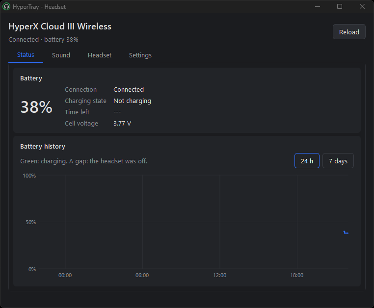

# HyperTray

A battery and status monitoring tool for the **HyperX Cloud III Wireless** (and compatible) headsets, written in Python with a native system tray interface.

Formerly *HyperHeadset_PY*. Settings, battery statistics and the autostart entry of the old version are carried over automatically on the first start. For the Dark Project Onionite V2 keyboard see the companion project **OnionTray**.

[](https://github.com/rafal-p4wlowski/HyperTray/releases/latest)

## Features

- **Headset Panel:** A click on the tray icon (or *Headset panel...* in the menu) opens a window with everything the headset supports. Polish and English UI, following the Windows language by default.
  - *Status:* battery level, charging, estimated time left, cell voltage and a battery chart of the last 24 hours or 7 days (green while charging, gaps while the headset was off).
  - *Sound:* microphone mute, side tone (mic monitoring) with its volume from -5 to +5, silent mode, and the Windows volume of the headset's microphone and headphones.
  - *Headset:* automatic shutdown (never, 10, 20 or 30 minutes), model, colour, firmware of the headset and the dongle, and the pairing (SIRK) reset with a confirmation.
  - *Settings:* start with Windows, battery refresh, language; the same choices as in the tray menu, kept in sync.
- **Battery Monitoring:** A ring around a headphones glyph fills clockwise with the battery level. It follows the taskbar colour (white on dark, black on light) and turns amber at 30% and red at 20%. The exact level is in the tooltip. Refresh interval from 5 s to 10 min, default 1 min.
- **Status Symbols:** While the microphone is muted a red crossed-out microphone replaces the headphones. While charging the ring turns green. When the headset is off the icon is dimmed.
- **Time Left:** Estimates the remaining battery time from how fast the battery drains, and learns the rate across sessions.
- **Live Events:** Mute button, side tone (hold the mute button), unplugged microphone, charger and headset power on/off are picked up immediately.
- **Verified Writes:** Every change waits for the headset's confirmation and is read back; a value the headset refuses snaps back in the panel.
- **Auto-Reconnect:** Recovers within seconds after the dongle is replugged or Windows resumes from sleep.
- **Microphone Control:** Toggle microphone mute from the tray menu or the panel.
- **Start with Windows:** Optional autostart, toggled from the Settings submenu or the panel.
- **Single Instance:** A second copy refuses to start, so two programs never fight over the dongle.
- **Lightweight:** The panel is freed when closed and idle memory is handed back to Windows (about 2.5 MB working set while idle).

The headset has no equalizer, microphone gain or voice prompt setting over USB (unlike the Cloud III S, which uses a different protocol). NGENUITY sets the volumes in Windows, and so does the panel.

## Screenshots

| Tray Hover (Battery Level) | Context Menu | Headset Panel |
| :---: | :---: | :---: |
|  |  |  |

## Installation

### Prerequisites

- **Python 3.9+**
- **hidapi:** `pip install hidapi` installs a prebuilt binary only for Python versions it has wheels for; on a newer Python it has to be compiled, which needs Microsoft C++ Build Tools. Alternatively install the `hid` package and put `hidapi.dll` (from [libusb/hidapi releases](https://github.com/libusb/hidapi/releases)) next to `main.py`.

### Steps

1. Clone the repository:
   ```bash
   git clone https://github.com/rafal-p4wlowski/HyperTray.git
   cd HyperTray
   ```

2. Install dependencies:
   ```bash
   pip install -r requirements.txt
   ```

## Usage

Run the application:
```bash
python main.py
```
The application will appear as an icon in your system tray. A click on the icon opens the headset panel; right-click it for the menu (status, microphone mute, settings).

A log is written to `%APPDATA%\HyperTray\hypertray.log`; the battery chart data is kept in `battery_history.json` next to it. Set the environment variable `HYPERTRAY_DEBUG=1` to also log every HID report.

## Creating an Executable (.exe)

To create a standalone `.exe` file for Windows:

1. Install PyInstaller:
   ```bash
   pip install pyinstaller
   ```
2. Build the application from the included spec file:
   ```bash
   pyinstaller --noconfirm HyperTray.spec
   ```
   The result is `dist/HyperTray.exe`. The spec file adds the application icon and version information and leaves out the parts of Qt the program does not use.

The application icon (`assets/icon.ico`) is generated by `python tools/make_icon.py`.

## Development

Tests run against a simulated dongle (`tests/fake_hid.py`, which also reproduces the firmware's delayed and silently refused writes) and simulated Windows audio devices, so no headset is needed:
```bash
pip install -r requirements-dev.txt
python -m pytest
```
GitHub Actions runs them on every push to `main` and on pull requests.

## Releasing

0. Optional test build: on GitHub open *Actions → Release → Run workflow*. It runs the tests and builds `HyperTray.exe` as a downloadable artifact without publishing anything.
1. Update `__version__` in `version.py` and commit.
2. Tag and push:
   ```bash
   git tag v2.2.0
   git push origin main --tags
   ```
3. GitHub Actions (`.github/workflows/release.yml`) builds `HyperTray.exe` and publishes it as a release. The build fails if the tag does not match `version.py`.

## Dependencies

- `hidapi`: For communication with the headset over HID.
- `PyQt6`: For the system tray icon, the context menu, the headset panel and rendering the battery level icon.

Windows audio volumes are set through Core Audio with `ctypes`; no extra package is needed.

## Attribution

The HID communication logic and protocol identifiers were implemented based on the original project by **Lennard Kittner**:
- **Original Repository:** [HyperHeadset](https://github.com/LennardKittner/HyperHeadset)
- **License:** MIT

Silent mode and the microphone events follow [hx-cloud3-wireless-linux-driver](https://github.com/yaroslavtarasov2019/hx-cloud3-wireless-linux-driver) (MIT). The value ranges, the write confirmations, the cell voltage, the device information and the microphone connection query were found and verified on the headset (dongle firmware 4.1.0.9, headset firmware 3.1.0.9).

## Credits

- Tray icon presentation (battery ring around a device glyph) after [HaloBattery](https://github.com/HeyOkay/HaloBattery) by HeyOkay (MIT).
- Headphones and mic-off glyphs from [Lucide](https://lucide.dev/) 1.17.0 (ISC, includes Feather's MIT notice), redrawn as Qt paths. License text: [licenses/lucide-1.17.0-LICENSE.txt](licenses/lucide-1.17.0-LICENSE.txt).

## License

This project is licensed under the MIT License.
