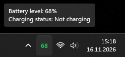
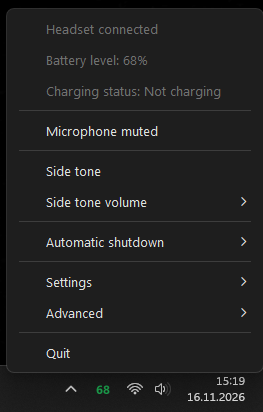

# HyperHeadset Python Tray

A battery and status monitoring tool for the **HyperX Cloud III Wireless** (and compatible) headsets, written in Python with a native system tray interface.

[](https://github.com/rafal-p4wlowski/HyperHeadset_PY/releases/latest)

## Features

- **Battery Monitoring:** Battery level displayed directly in the system tray icon (polled every 10 s, 30 s or 1 min).
- **Status Badges:** The tray icon shows a lightning bolt while charging and a red badge while the microphone is muted.
- **Time Left:** Estimates the remaining battery time from how fast the battery drains, and learns the rate across sessions.
- **Live Events:** Mute button, charger and headset power on/off are picked up immediately.
- **Auto-Reconnect:** Recovers within seconds after the dongle is replugged or Windows resumes from sleep.
- **Charging Status:** View whether the headset is currently charging.
- **Microphone Control:** Toggle microphone mute from the menu or with a left click on the tray icon.
- **Side Tone:** Enable/Disable side tone and adjust its volume (0, 50, 100, 200).
- **Auto-Shutdown:** Configure automatic shutdown timer (Disabled, 5, 10, 15, 30, 45, 60, 90, or 120 minutes).
- **Start with Windows:** Optional autostart, toggled from the Settings submenu.
- **Pairing Reset (experimental):** *Advanced → Reset headset pairing (SIRK)* resets the pairing key after a confirmation. The headset may need to be paired with the dongle again afterwards.
- **Single Instance:** A second copy refuses to start, so two programs never fight over the dongle.
- **Premium UI:** Sleek, dark-themed context menu powered by PyQt6.
- **Lightweight:** Runs silently in the background with minimal resource usage.

## Screenshots

| Tray Hover (Battery Level) | Context Menu (Settings) |
| :---: | :---: |
|  |  |

## Installation

### Prerequisites

- **Python 3.9+**
- **hidapi:** `pip install hidapi` installs a prebuilt binary only for Python versions it has wheels for; on a newer Python it has to be compiled, which needs Microsoft C++ Build Tools. Alternatively install the `hid` package and put `hidapi.dll` (from [libusb/hidapi releases](https://github.com/libusb/hidapi/releases)) next to `main.py`.

### Steps

1. Clone the repository:
   ```bash
   git clone https://github.com/rafal-p4wlowski/HyperHeadset_PY.git
   cd HyperHeadset_PY
   ```

2. Install dependencies:
   ```bash
   pip install -r requirements.txt
   ```

## Usage

Run the application:
```bash
python main.py
```
The application will appear as an icon in your system tray. Right-click the icon to access the menu and settings; left-click toggles the microphone mute (can be turned off in Settings).

A log is written to `%APPDATA%\HyperHeadset\hyperheadset.log`. Set the environment variable `HYPERHEADSET_DEBUG=1` to also log every HID report.

## Creating an Executable (.exe)

To create a standalone `.exe` file for Windows:

1. Install PyInstaller:
   ```bash
   pip install pyinstaller
   ```
2. Build the application from the included spec file:
   ```bash
   pyinstaller --noconfirm HyperHeadset.spec
   ```
   The result is `dist/HyperHeadset.exe`. The spec file adds the application icon and version information and leaves out the parts of Qt the program does not use.

The application icon (`assets/icon.ico`) is generated by `python tools/make_icon.py`.

## Releasing

1. Update `__version__` in `version.py` and commit.
2. Tag and push:
   ```bash
   git tag v2.0.0
   git push origin main --tags
   ```
3. GitHub Actions (`.github/workflows/release.yml`) builds `HyperHeadset.exe` and publishes it as a release. The build fails if the tag does not match `version.py`.

## Dependencies

- `hidapi`: For communication with the headset over HID.
- `PyQt6`: For the system tray icon, the context menu and rendering the battery level icon.

## Attribution

The HID communication logic and protocol identifiers were implemented based on the original project by **Lennard Kittner**:
- **Original Repository:** [HyperHeadset](https://github.com/LennardKittner/HyperHeadset)
- **License:** MIT

## License

This project is licensed under the MIT License.
